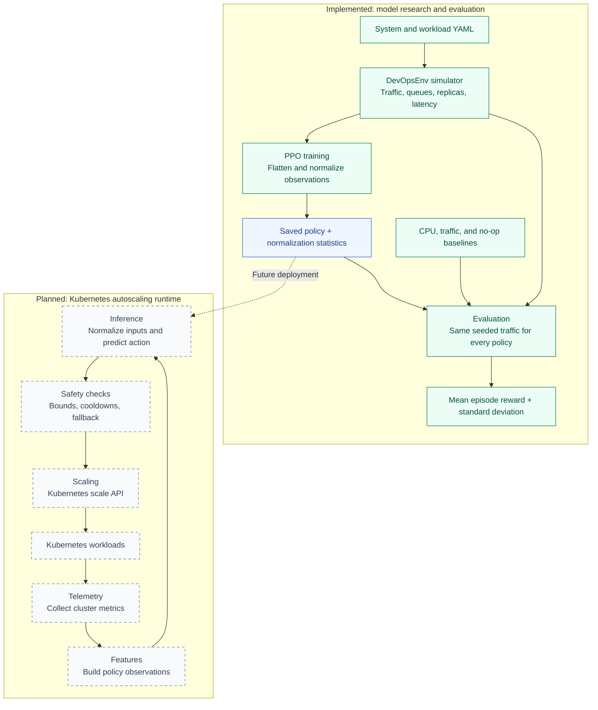
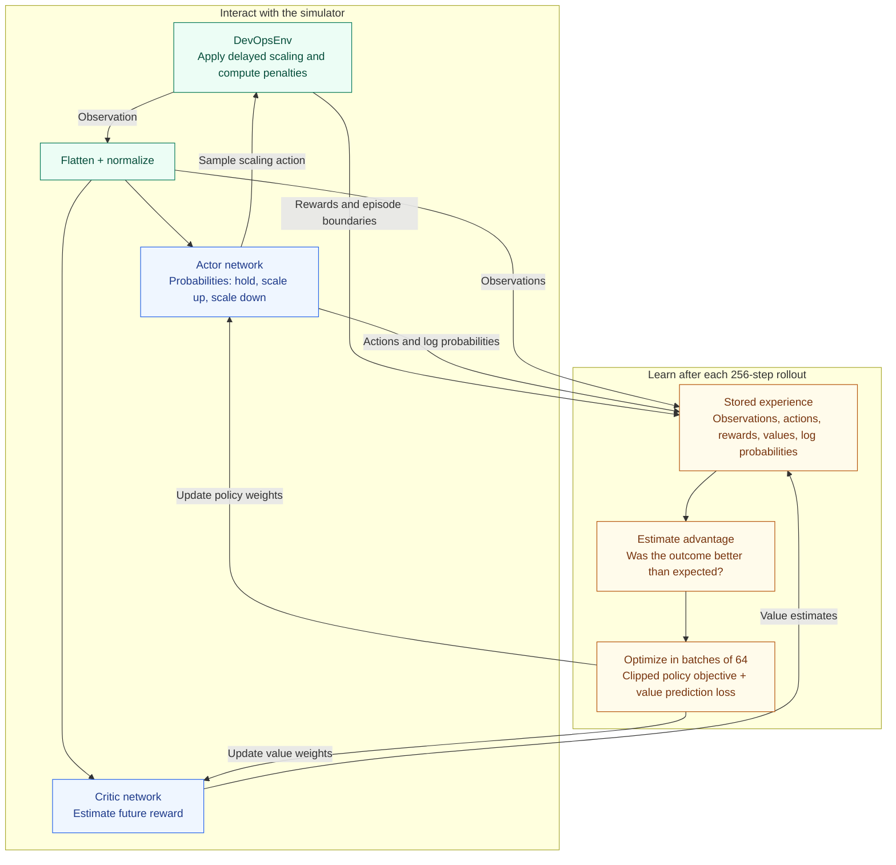

# Kubereasy

Kubereasy explores reinforcement learning for Kubernetes autoscaling: deciding when to add or remove replicas while balancing infrastructure cost and application latency.

The project starts with a local simulator where a PPO agent and rule-based autoscalers face the same traffic patterns. The simulator models request queues, replica limits, and provisioning delays so policies must account for the time it takes a scaling decision to affect capacity.

## Project status

The research workflow in [`model/`](model/) is implemented: simulate workloads, train a policy, and compare it with deterministic baselines. The Kubernetes runtime, deployment manifests, observability assets, and shared contracts are scaffolded for future development. Running the simulator requires no Kubernetes cluster.

## Project architecture

The implemented research workflow produces a policy and its normalization statistics for evaluation. The dashed connection shows the planned path from those artifacts to a Kubernetes controller; the runtime components below are still scaffolded.



## Quick start

Clone the repository and create a Python virtual environment inside `model/`:

```bash
git clone https://github.com/noah-stokes/kubereasy.git
cd kubereasy/model

python3 -m venv .venv
source .venv/bin/activate
python -m pip install -r requirements.txt
```

Run the existing test suite:

```bash
python -m unittest discover -s tests -v
```

Run all commands below from `model/` with the virtual environment activated. The simulator loads configuration files relative to this directory.

## Train and evaluate

Train a PPO policy with a fixed seed:

```bash
python -m training.train --timesteps 100000 --seed 0
```

Training saves two files:

- `models/ppo_devops.zip` — the trained policy.
- `models/ppo_devops.vecnormalize.pkl` — the observation normalization statistics needed for evaluation.

Compare the policy against the baselines over ten episodes:

```bash
python -m training.evaluate --model models/ppo_devops --episodes 10 --seed 10000
```

Each policy receives the same seeded workload for each episode. Evaluation prints mean total episode reward and standard deviation, sorted by mean reward. Higher reward means a lower combined penalty for replica cost, latency violations, and rejected scaling actions within this simulator.

To save and evaluate a separate experiment, use matching output and model paths:

```bash
python -m training.train --timesteps 100000 --seed 42 --output models/experiment_42
python -m training.evaluate --model models/experiment_42 --episodes 10 --seed 10000
```

View training metrics with TensorBoard:

```bash
tensorboard --logdir logs/tensorboard
```

Generated models, logs, and the virtual environment are excluded from Git by [`model/.gitignore`](model/.gitignore).

## How the simulator works

[`DevOpsEnv`](model/env/DevOpsEnv.py) is a Gymnasium environment with three actions: hold the current allocation, request one additional replica, or request removal of one replica. Scaling requests take effect after a configured delay and must respect replica bounds, including pending changes.

The observation includes traffic in requests per second, simulated p95 latency, CPU utilization, queue depth, active replicas, pending replica changes, and the time until the next pending change completes. Requests exceeding available capacity accumulate in a queue and increase simulated latency.

The reward penalizes active replica cost at every step. Latency above the configured limit adds a fixed penalty and a capped severity penalty; rejected scaling requests add another penalty. These metrics and costs are simulated values used to compare policies.

### Policies

| Policy | Behavior |
| --- | --- |
| `ppo` | Learns a scaling policy with Stable-Baselines3 PPO using normalized observations. |
| `cpu` | Adds a replica at CPU utilization of 75% or higher; removes one at 35% or lower. Waits while a replica change is pending. |
| `traffic` | Targets 70% utilization using incoming traffic and per-replica capacity, accounting for pending replica changes. |
| `no_op` | Keeps the starting replica count throughout the episode. |

The deterministic policies live in [`model/agents/baselines.py`](model/agents/baselines.py).

## How PPO learns to scale

**Proximal Policy Optimization (PPO)** learns from interaction with the simulator. Its **actor** assigns probabilities to the three scaling actions; its **critic** estimates the discounted future reward from the current observation. During training, actions are sampled from the actor's distribution so the agent can explore different decisions.



1. **Collect experience.** The current policy interacts with one simulated environment for 256 steps. Each reward reflects replica cost, latency penalties, and any rejected scaling request.
2. **Estimate advantage.** PPO compares the rewards and estimated future value with the critic's prediction to estimate whether an action did better or worse than expected.
3. **Improve the policy.** Actions with positive advantage become more likely, while those with negative advantage become less likely. PPO uses a clipped objective to discourage abrupt changes in action probabilities, and trains the critic to improve its value estimates.
4. **Repeat.** The updated policy collects another rollout and learns again until the training run finishes. See the [original PPO paper](https://arxiv.org/abs/1707.06347) and [Stable-Baselines3 PPO documentation](https://stable-baselines3.readthedocs.io/en/master/modules/ppo.html) for the algorithm and implementation details.

In [`model/training/train.py`](model/training/train.py), the actor and critic each have two hidden layers of 64 units. Observations are flattened and normalized with `VecNormalize`; rewards retain their original scale. The model and normalization statistics are saved together so evaluation can reuse the same input transformation.

This objective lets the agent learn about delayed consequences: an extra replica costs money now but may reduce queue buildup and latency penalties later. During evaluation, normalization statistics are frozen and the policy selects the most likely action deterministically. The baseline comparison measures whether the learned policy achieves a better total reward under the tested workloads.

## Configuration

Edit the YAML files before starting a new training or evaluation run:

| File | Controls |
| --- | --- |
| [`model/configs/system.yaml`](model/configs/system.yaml) | Per-replica capacity, provisioning delay, replica bounds, replica cost, latency limit, and reward penalties. |
| [`model/configs/workload.yaml`](model/configs/workload.yaml) | Episode length, traffic parameters, period, and noise. |

The default system has 100 requests/second of capacity per replica, a six-step provisioning delay, a replica range of 1–20, and a 200 ms latency limit. Scale-down delay defaults to the provisioning delay; add `scale_down_delay` to the system configuration to set it independently.

Episodes use 1,000 steps of noisy periodic traffic by default. [`WorkloadGenerator`](model/env/workload.py) also provides constant and ramp generators, and `DevOpsEnv(traffic=...)` accepts a custom nonnegative traffic sequence for controlled experiments.

## Repository layout

Model research and training are kept separate from the planned Kubernetes runtime:

```text
.
├── model/                  # Implemented research workflow
│   ├── agents/             # Deterministic baseline policies
│   ├── configs/            # System and workload parameters
│   ├── env/                # Gymnasium environment and simulation
│   ├── tests/              # Environment, baseline, and training/evaluation tests
│   └── training/           # PPO training and policy comparison
├── runtime/
│   ├── src/kubereasy_autoscaler/
│   │   ├── controller/     # Reconciliation and decision loop
│   │   ├── telemetry/      # Prometheus and Kubernetes metric collection
│   │   ├── features/       # History windows and feature preparation
│   │   ├── inference/      # Model loading and prediction
│   │   ├── safety/         # Bounds, cooldowns, fallbacks, and kill switch
│   │   └── scaling/        # Kubernetes /scale integration
│   ├── config/             # Runtime configuration
│   └── tests/              # Runtime unit and integration tests
├── contracts/              # Planned feature, decision, and model schemas
├── deploy/                 # Scaffold for Helm and Kubernetes manifests
├── observability/          # Scaffold for dashboards and alerts
├── examples/               # Scaffold for workloads and policies
├── tests/e2e/              # Scaffold for cluster tests
├── docs/                   # Scaffold for architecture notes and runbooks
└── scripts/                # Scaffold for development and release scripts
```

## License

[MIT](LICENSE) © 2026 Noah Stokes.
